  <!-- S-Rank Hero Banner -->
  

    

  <!-- Dynamic Typing Headline in Electric Cyan -->
  

  <!-- Social Badges & Profile Views -->
  

    
    &nbsp;
    
    &nbsp;
    
  

  

    
  

---

### 🚀 Selected Work & Production Deployments

<table>
  <tr>
    <td width="50%" valign="top">
      <h3 align="center">🤖 <a href="https://github.com/Nishant052004/LEXI">LEXI — Multi-Agent OS</a></h3>
      
Autonomous multi-agent intelligence platform orchestrating dynamic tool execution, reasoning workflows, and live task routing.

      

        
        
        
      

    </td>
    <td width="50%" valign="top">
      <h3 align="center">⚡ <a href="https://github.com/Nishant052004/Agentic-RAG-Assistant">Agentic RAG Assistant</a></h3>
      
3-agent document Q&A architecture featuring retrieval, answering, and strict automated anti-hallucination verification.

      

        
        
        
      

    </td>
  </tr>
  <tr>
    <td width="50%" valign="top">
      <h3 align="center">🛡️ <a href="https://github.com/Nishant052004/Human-in-the-loop">HAULT: Human-in-the-Loop</a></h3>
      
DevOps command suite and safety framework ensuring policy compliance and human oversight in autonomous AI decision cycles.

      

        
        
        
      

    </td>
    <td width="50%" valign="top">
      <h3 align="center">🩸 <a href="https://github.com/Nishant052004/PulseBridge-WEB">PulseBridge Platform</a></h3>
      
Production-grade peer discovery network connecting voluntary blood donors and medical receivers with zero-leak privacy controls.

      

        
        
        
      

    </td>
  </tr>
  <tr>
    <td width="50%" valign="top">
      <h3 align="center">📄 <a href="https://github.com/Nishant052004/RESUME-IQ">ResumeIQ — AI Screener</a></h3>
      
Intelligent candidate resume parser that analyzes skill gaps, scores role fit, and delivers actionable recommendations.

      

        
        
        
      

    </td>
    <td width="50%" valign="top">
      <h3 align="center">🌿 <a href="https://github.com/Nishant052004/Plant-Diseases">FloraScan AI</a></h3>
      
Deep learning crop pathology solution providing instant leaf disease detection, risk diagnosis, and treatment suggestions.

      

        
        
        
      

    </td>
  </tr>
</table>

---

### 🛠️ Tech Stack & Verified Architecture

<table>
  <tr>
    <td align="center" width="160"><b>🗣️ Languages</b></td>
    <td>
      
    </td>
  </tr>
  <tr>
    <td align="center"><b>🤖 AI / ML & Agents</b></td>
    <td>
      
      &nbsp;
      
      
      
      
      
    </td>
  </tr>
  <tr>
    <td align="center"><b>🌐 Frontend</b></td>
    <td>
      
    </td>
  </tr>
  <tr>
    <td align="center"><b>⚙️ Backend</b></td>
    <td>
      
    </td>
  </tr>
  <tr>
    <td align="center"><b>🗄️ Databases</b></td>
    <td>
      
      &nbsp;
      
      
    </td>
  </tr>
  <tr>
    <td align="center"><b>🔧 DevOps & Tooling</b></td>
    <td>
      
    </td>
  </tr>
</table>

 

> **📋 Verified Stack:** Every technology above corresponds directly to production implementations and actual repository dependencies across my work.

---

### 👾 Interactive Terminal & Status Card

---

### 📊 Real-Time GitHub Analytics

  
  

   
  

   
  

---

  

    

  ⚡ Engineered with passion by <b>Nishant Rai</b> • Built with precision

